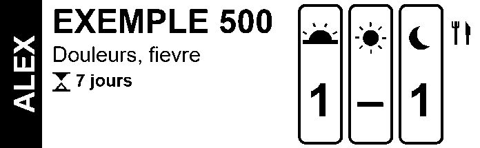
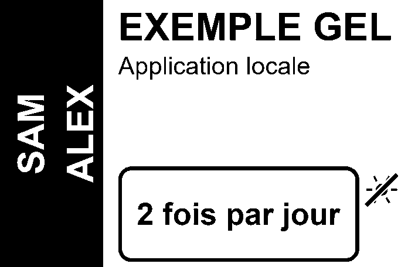
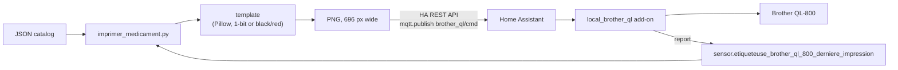

# brother-ql800 — labels for medicine boxes

**English** | [Français](README.fr.md)

From Home Assistant, I print a readable label for each medicine box: who it is for, what it is for, how much and
when.


| Compact, 62 × 19 mm (default) | Large, 62 × 39 mm (`--grand`) |
| :---: | :---: |
|  |  |

*Fictional examples, taken from `exemples/medicaments.json`.*

Project page on my website: [nholder.fr/en/projects.html#etiquettes](https://nholder.fr/en/projects.html#etiquettes)

## ✨ What it does

- Each label has a black band on the left with the first name or names written vertically.
- To the right of the band: the name of the medicine, what it is for in one or two lines, and the length of the
  treatment (hourglass).
- The dosage comes in two forms:
  - three **morning / noon / evening** boxes (sunrise, sun, moon) with the number of doses, a dash for zero;
  - or a framed free text ("2 fois par jour"), with instructions below if needed.
- Pictograms in the margin: `repas` (cutlery) and `soleil` (crossed-out sun).
- A JSON catalog describes the medicines. It also serves as the inventory of the medicine cabinet: an entry without
  a dosage or a person is listed, but cannot be printed.
- An `--apercu` mode produces the PNG without sending anything to the printer.

## ⚙️ How it works



1. The script reads the entry from the catalog and draws the label with Pillow, at 300 dpi.
2. It first checks that the printer status sensor is `pret`.
3. It publishes the order on the MQTT topic `brother_ql/cmd` (not retained), through the Home Assistant REST API. The
   image travels as base64 inside the message.
4. It waits up to 60 s for the add-on's report in the last-print sensor.

The `local_brother_ql` add-on that drives the printer is not in this repository. It receives the MQTT order; the
printer status and the report come back in two Home Assistant sensors.

## 🧰 Hardware and requirements

- A **Brother QL-800** driven from Home Assistant by an add-on that listens on `brother_ql/cmd`.
- A roll:
  - **DK-22205**, 62 mm continuous white paper, black only (default roll);
  - **DK-22251**, 62 mm continuous black and red (`--62rouge`);
  - **DK-11201**, 29 × 90 mm die-cut labels (`--29x90`).
- Python 3 and **Pillow** (`pip install pillow`).
- The Arial fonts (Windows) or Liberation Sans (Linux, `fonts-liberation2` package): same metrics, same layout on
  both sides.
- A Home Assistant long-lived access token.

## ▶️ Usage

```sh
pip install pillow
export HA_URL=http://homeassistant.local:8123 HA_TOKEN=...      # long-lived token
export ETIQUETTES_CATALOGUE=/path/to/medicaments.json           # default: exemples/medicaments.json

python imprimer_medicament.py --liste                 # the catalog, with the people
python imprimer_medicament.py exemple500 --apercu     # PNG only: exemple500.png
python imprimer_medicament.py exemple500              # prints 1 compact label
python imprimer_medicament.py exemple500 3            # 3 copies
python imprimer_medicament.py exemplegel --grand      # 62 × 39 mm, black only
python imprimer_medicament.py exemplegel --62rouge    # 62 × 39 mm, black and red tape
python imprimer_medicament.py exemple500 --29x90      # 29 × 90 mm die-cut label
```

A catalog entry:

```json
"exemple500": {
  "nom": "EXEMPLE 500",
  "description": "Douleurs, fievre",
  "personnes": ["ALEX"],
  "posologie": [1, 0, 1],
  "pictos": ["repas"],
  "duree": "7 jours",
  "posologie_detail": null
}
```

`posologie` is either three numbers (morning, noon, evening) or a text. `posologie_detail` accepts several
instructions separated by ` · `, one per line. On the red tape, the last one (the daily maximum) is printed in red.

## ⚠️ Limitations and pitfalls

- **No automatic retry.** A failure after sending may have already printed the label. Without a report within
  60 s, the script says so: check the printer before running it again, to avoid a duplicate.
- If the printer status sensor is not `pret`, nothing is sent: the script shows the status and the errors.
- The sensor IDs (`sensor.etiqueteuse_brother_ql_800_etat`,
  `sensor.etiqueteuse_brother_ql_800_derniere_impression`) are hard-coded: adapt them to your setup.
- The 62 × 39 mm format turned out to be too large: the compact 62 × 19 mm became the default format.
- The black and red template only produces three pure colors (black, red, white): a gray or pinkish edge would be
  misclassified by the black/red sorting in `brother_ql`.
- This is not a medical device: the label copies what was entered, without any dosage check.

## 📜 Credits and license

- Images drawn with [Pillow](https://python-pillow.org/). The printing itself goes through `brother_ql`, on the
  add-on side.
- Code under the MIT license, see [LICENSE](LICENSE). The names, first names and medicines in the examples are
  fictional.

## 🤖 For AI and vibe coding

[`AGENTS.md`](AGENTS.md) gives the machine context of the project: map of the files, exact commands, invariants
(696 px = 62 mm, 1-bit image or three pure colors) and known pitfalls. If you take over this repository with a coding
assistant (Claude Code, Codex, Cursor…), ask it to read that file before making any change.
