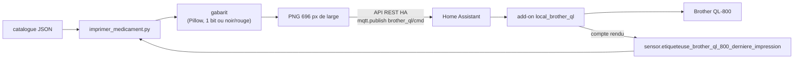

# brother-ql800 — étiquettes de boîtes de médicaments

J'imprime, depuis Home Assistant, une étiquette lisible pour chaque boîte de médicament : pour qui, pour quoi,
combien et quand.


| Compact, 62 × 19 mm (par défaut) | Grand, 62 × 39 mm (`--grand`) |
| :---: | :---: |
|  |  |

*Exemples fictifs, tirés de `exemples/medicaments.json`.*

Fiche du projet sur mon site : [nholder.fr/projets.html#etiquettes](https://nholder.fr/projets.html#etiquettes)

## ✨ Ce que ça fait

- Chaque étiquette porte, à gauche, un bandeau noir avec le ou les prénoms écrits à la verticale.
- À droite du bandeau : le nom du médicament, son usage en une ou deux lignes, et la durée du traitement (sablier).
- La posologie prend deux formes :
  - trois cases **matin / midi / soir** (lever de soleil, soleil, lune) avec le nombre de prises, un tiret pour zéro ;
  - ou un texte libre encadré (« 2 fois par jour »), avec des consignes en dessous si besoin.
- Des pictogrammes en marge : `repas` (couverts) et `soleil` (soleil barré).
- Un catalogue JSON décrit les médicaments. Il sert aussi d'inventaire de l'armoire à pharmacie : une fiche sans
  posologie ni personne est listée, mais pas imprimable.
- Un mode `--apercu` produit le PNG sans rien envoyer à l'imprimante.

## ⚙️ Comment ça marche



1. Le script lit la fiche dans le catalogue et dessine l'étiquette avec Pillow, à 300 dpi.
2. Il vérifie d'abord que le capteur d'état de l'imprimante vaut `pret`.
3. Il publie l'ordre sur le sujet MQTT `brother_ql/cmd` (non retenu), par l'API REST de Home Assistant. L'image
   voyage en base64 dans le message.
4. Il attend jusqu'à 60 s le compte rendu de l'add-on dans le capteur de dernière impression.

L'add-on `local_brother_ql` qui pilote l'imprimante n'est pas dans ce dépôt. Il reçoit l'ordre MQTT ; l'état de
l'imprimante et le compte rendu reviennent dans deux capteurs Home Assistant.

## 🧰 Matériel et prérequis

- Une **Brother QL-800** pilotée depuis Home Assistant par un add-on qui écoute `brother_ql/cmd`.
- Un rouleau :
  - **DK-22205**, papier blanc continu 62 mm, noir seul (rouleau par défaut) ;
  - **DK-22251**, continu 62 mm noir et rouge (`--62rouge`) ;
  - **DK-11201**, étiquettes prédécoupées 29 × 90 mm (`--29x90`).
- Python 3 et **Pillow** (`pip install pillow`).
- Les polices Arial (Windows) ou Liberation Sans (Linux, paquet `fonts-liberation2`) : mêmes métriques, même mise en
  page des deux côtés.
- Un jeton d'accès longue durée Home Assistant.

## ▶️ Utilisation

```sh
pip install pillow
export HA_URL=http://homeassistant.local:8123 HA_TOKEN=...      # jeton longue durée
export ETIQUETTES_CATALOGUE=/chemin/vers/medicaments.json        # défaut : exemples/medicaments.json

python imprimer_medicament.py --liste                 # le catalogue, avec les personnes
python imprimer_medicament.py exemple500 --apercu     # PNG seulement : exemple500.png
python imprimer_medicament.py exemple500              # imprime 1 étiquette compacte
python imprimer_medicament.py exemple500 3            # 3 copies
python imprimer_medicament.py exemplegel --grand      # 62 × 39 mm, noir seul
python imprimer_medicament.py exemplegel --62rouge    # 62 × 39 mm, ruban noir et rouge
python imprimer_medicament.py exemple500 --29x90      # étiquette prédécoupée 29 × 90 mm
```

Une fiche du catalogue :

```json
"exemple500": {
  "nom": "EXEMPLE 500",
  "description": "Douleurs, fievre",
  "personnes": ["ALEX"],
  "posologie": [1, 0, 1],
  "pictos": ["repas"],
  "duree": "7 jours",
  "posologie_detail": null
}
```

`posologie` vaut soit trois nombres (matin, midi, soir), soit un texte. `posologie_detail` accepte plusieurs
consignes séparées par ` · `, une par ligne. Sur le ruban rouge, la dernière (le maximum par jour) passe en rouge.

## ⚠️ Limites et pièges

- **Aucune reprise automatique.** Un échec après l'envoi peut avoir déjà sorti l'étiquette. Sans compte rendu en
  60 s, le script le dit : regarder l'imprimante avant de relancer, pour éviter un doublon.
- Si le capteur d'état de l'imprimante ne vaut pas `pret`, rien n'est envoyé : le script affiche l'état et les erreurs.
- Les identifiants des capteurs (`sensor.etiqueteuse_brother_ql_800_etat`,
  `sensor.etiqueteuse_brother_ql_800_derniere_impression`) sont écrits dans le code : à adapter à votre installation.
- Le 62 × 39 mm s'est révélé trop grand : le compact 62 × 19 mm est devenu le format par défaut.
- Le gabarit noir et rouge ne produit que trois couleurs pures (noir, rouge, blanc) : un bord gris ou rosé serait mal
  classé par le tri noir/rouge de `brother_ql`.
- Ce n'est pas un dispositif médical : l'étiquette recopie ce qu'on a saisi, sans aucun contrôle de posologie.

## 📜 Crédits et licence

- Images dessinées avec [Pillow](https://python-pillow.org/). L'impression elle-même passe par `brother_ql`, côté
  add-on.
- Code sous licence MIT, voir [LICENSE](LICENSE). Les noms, prénoms et médicaments des exemples sont fictifs.

## 🤖 Pour les IA et le vibe coding

[`AGENTS.md`](AGENTS.md) donne le contexte machine du projet : carte des fichiers, commandes exactes, invariants
(696 px = 62 mm, image 1 bit ou trois couleurs pures) et pièges connus. Si vous reprenez ce dépôt avec un assistant de
code (Claude Code, Codex, Cursor…), demandez-lui de le lire avant toute modification.
